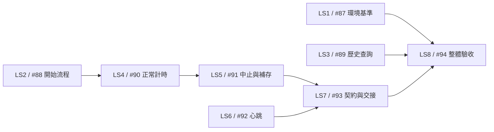

# Log Solution 改善開發票 — 2026-10-20

來源：[規格Issue #86](https://github.com/Bowei1121/B518_205_207_ATE/issues/86)／[正式規格](../LOG_SOLUTION_IMPROVEMENT_SPEC_2026-10-20.md)。

使用者已核准八票拆法與依賴；八票均已發布為原生子議題，套用ready-for-agent。父規格正文、標題、狀態、標籤及留言保持原樣，只新增必要的子議題關聯。

## 票務對照

| 開發票 | GitHub | 前置票 | 本機完整內容 |
| --- | --- | --- | --- |
| LS1：開發與打包共同核對 Python 3.12.10 | [#87](https://github.com/Bowei1121/B518_205_207_ATE/issues/87) | 無，可立即開始 | [01-python-baseline.md](01-python-baseline.md) |
| LS2：統一開始監控與正確的失敗原因 | [#88](https://github.com/Bowei1121/B518_205_207_ATE/issues/88) | 無，可立即開始 | [02-start-flow.md](02-start-flow.md) |
| LS3：集中歷史查詢、取消與視窗生命週期 | [#89](https://github.com/Bowei1121/B518_205_207_ATE/issues/89) | 無，可立即開始 | [03-historical-query.md](03-historical-query.md) |
| LS4：正常監控的固定分秒計時與耗時保存 | [#90](https://github.com/Bowei1121/B518_205_207_ATE/issues/90) | [#88](https://github.com/Bowei1121/B518_205_207_ATE/issues/88) | [04-normal-round-timer.md](04-normal-round-timer.md) |
| LS5：中止、失敗與補存時保留正確監控時間 | [#91](https://github.com/Bowei1121/B518_205_207_ATE/issues/91) | [#90](https://github.com/Bowei1121/B518_205_207_ATE/issues/90) | [05-timer-abort-recovery.md](05-timer-abort-recovery.md) |
| LS6：全狀態半秒四格心跳與同列顯示 | [#92](https://github.com/Bowei1121/B518_205_207_ATE/issues/92) | 無，可立即開始 | [06-independent-heartbeat.md](06-independent-heartbeat.md) |
| LS7：實測顯示契約並交付 Claude 橋接資料 | [#93](https://github.com/Bowei1121/B518_205_207_ATE/issues/93) | [#91](https://github.com/Bowei1121/B518_205_207_ATE/issues/91)、[#92](https://github.com/Bowei1121/B518_205_207_ATE/issues/92) | [07-display-contract-handoff.md](07-display-contract-handoff.md) |
| LS8：整體桌面驗收、打包與交付證據 | [#94](https://github.com/Bowei1121/B518_205_207_ATE/issues/94) | [#87](https://github.com/Bowei1121/B518_205_207_ATE/issues/87)、[#89](https://github.com/Bowei1121/B518_205_207_ATE/issues/89)、[#93](https://github.com/Bowei1121/B518_205_207_ATE/issues/93) | [08-integration-release.md](08-integration-release.md) |

## 依賴圖

## 認領與完成規則

- 起始可認領LS1、LS2、LS3、LS6；其餘票只有所有原生Blocked by均完成後才可認領。ready-for-agent不代表沒有前置依賴。
- LS2先整理開始流程，LS4才加入計時；LS3的歷史查詢可獨立完成，不阻擋心跳。
- LS4是正常一輪的開始、畫面、停表、保存與重讀；LS5是異常中止、未受理失敗與保存重試，不是按資料／畫面／測試拆水平票。
- LS7以真正KVM接收影像定稿幾何及Claude交接，LS8完成App整體驗收。缺目標機或配對環境須明列尚未驗收，不以過去結果替代。
- 橋接程式、TCP／LabVIEW與橋接恢復策略由使用者及Claude另案處理；本組票不擴張為橋接實作。
- 各票都要完成自己的實際行為驗證；LS8只做整合，不替代前段測試。不可因共用程式檔案就添加不必要的產品依賴，整合時仍須協調。
- 每票驗收延續既有結果、人工確認、復位、取消、完整保存及交付政策；不以大量轉呼叫或檔案數判定優化成功。

## 規格覆蓋

| 開發票 | 使用情境 | 驗收情境 |
| --- | --- | --- |
| LS1 | 51 | T19 |
| LS2 | 46、47、48、49、50 | T04、T17、T18 |
| LS3 | 39、40、41、42、43、44、45 | T14、T15、T16 |
| LS4 | 1、2、3、4、5、6、7、14、15、16、17、18、19、20、21、22、23、24、25、26 | T01、T02、T05、T06、T07、T13 |
| LS5 | 8、9、10、11、12、13、16、17 | T02、T03、T04、T05、T18 |
| LS6 | 27、28、29、30、31、32、34 | T08、T09、T10 |
| LS7 | 21、23、24、25、26、33、34、35、36、37、38 | T07、T10、T11、T12、T13 |
| LS8 | 1～52（整合） | T01～T19（整合） |

使用情境1～51各有前段實作票負責，52由LS8負責；全部52個使用情境及19組驗收情境已覆蓋。可讀取tickets.json取得同一份編號／依賴對照。

本次工作只建立與保存開發票，沒有實作產品功能；文件中可交付結果與驗收勾選項均是後續工作要求，不表示已完成。
